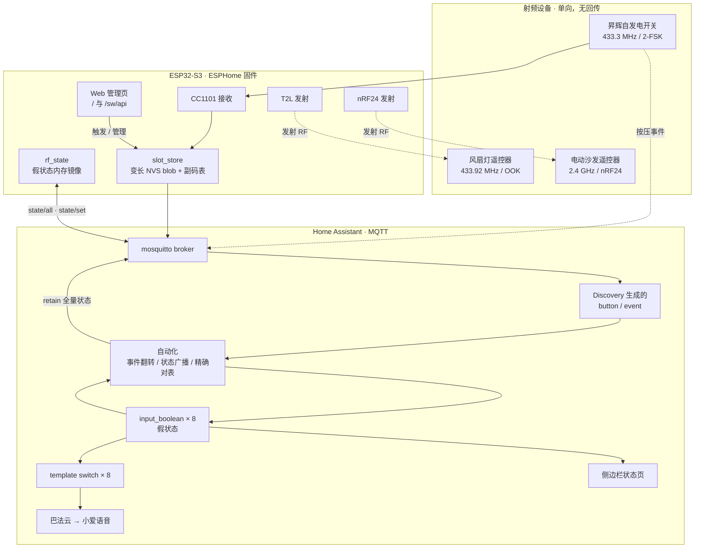
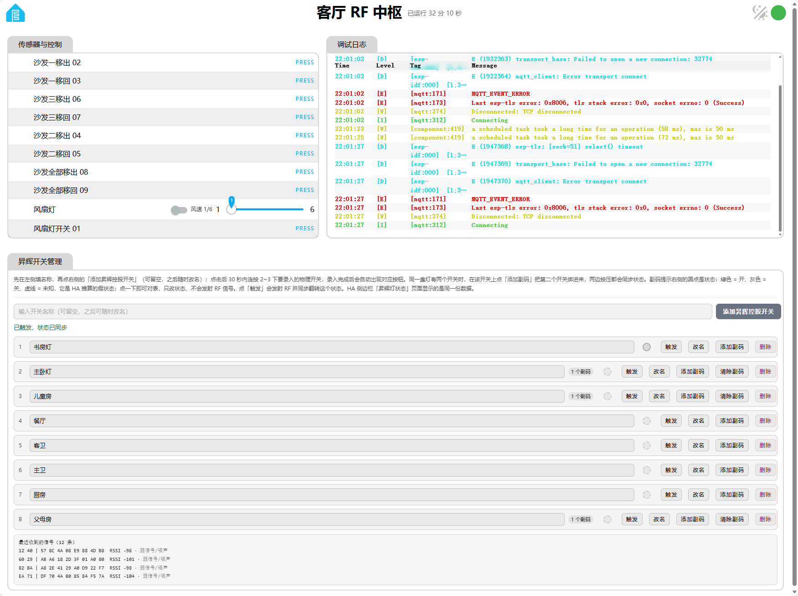
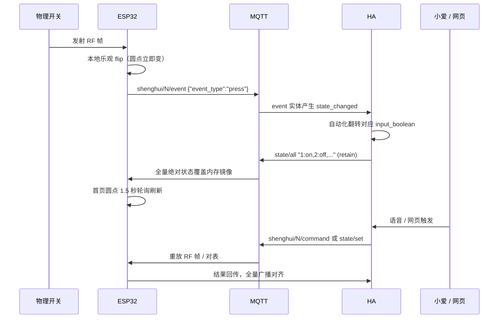

# 客厅 RF 中枢

> 用一块 ESP32-S3 + ESPHome，把三套互不兼容的老式射频设备接进 Home Assistant：昇辉自发电开关、433 MHz 风扇灯、nRF24 电动沙发。重点解决 **RF 单向发射、没有状态回传** 带来的假状态同步、双控状态反相和语音控制问题。

---

## 它解决了什么问题

| 痛点 | 处理方式 |
| --- | --- |
| 原厂 RF 开关只发射、不回传，HA 不知道灯现在是开是关 | HA 侧用 `input_boolean` 维护「假状态」，设备侧保留一份内存镜像，靠 MQTT 双向对齐 |
| 一盏灯由两个物理开关控制，两个开关发的码不一样，语音会反相 | 「一槽多码」：一个主槽位可绑多个副码，命中任一码都按同一个槽位 ID 上报 |
| 固定 8 个槽位不够，且改数组长度会丢 NVS 旧数据 | 变长 NVS blob，槽位数量无固定上限；旧 8 槽在首次启动时无损迁移 |
| 网页里录入的开关不会自动变成 HA 实体 | 手写 MQTT Discovery，录入 / 改名 / 删除即时同步成 HA 的 button 与 event |
| 物理开关连按两次，HA 只能看到一次 | 用 MQTT `event` 实体上报每次按压，而不是只看 on/off 状态 |
| ESPHome 自带首页没有开关管理界面 | 在官方 v3 首页注入脚本，新增「昇辉开关管理」区块与 `/sw/api` 接口 |

---

## 系统架构



---

## 功能特性

- **动态昇辉槽位**：网页填名称 → 30 秒内连按 2~3 下物理开关完成录入；可随时改名 / 删除 / 触发。槽位 ID 单调递增、删除后永不复用（HA 实体与自动化按 ID 绑定，复用会串到旧实体）。
- **双控副码**：每个槽位可再绑多个 RF 帧，命中副码仍按主槽位 ID 上报，HA 侧实体、topic、自动化完全不用改。
- **抗噪声学习**：CC1101 在空闲时每 0.5~2 秒会收到随机噪声包，原「连续两帧相同」会被噪声插队打断。改为 3 秒滑动窗口内找重复帧（允许 1 字节误码），并要求连按 2~3 下。
- **官方风扇卡片**：`template fan`，6 挡滑块 + 正反转 + 开关，滑块防抖 250 ms 后才发一组 RF 帧。
- **假状态可视化**：HA 侧边栏「昇辉灯状态」页面 + 设备首页状态圆点（绿＝开、灰＝关、虚线＝未知），点击圆点只改假状态、不发射 RF。
- **中文管理界面**：中文分组标题、中文运行时长、调试日志与实体表等高、日志内部滚动且新消息自动到底（手动上翻时不打断）。
- **MQTT 掉线不重启设备**：`reboot_timeout: 0s`，射频中枢不会因为 broker 抖动而重启。

---

## 界面预览

### 设备自带管理页（`http://<设备 IP>/`）



> 在 ESPHome 官方 v3 首页上注入的「昇辉开关管理」区块。上排左为静态实体（沙发 8 个动作、`template fan` 6 挡滑块），右为与之等高、内部滚动且自动跟随的调试日志；中间是动态槽位列表：副码徽标、状态圆点（绿＝开 / 灰＝关）、触发 / 改名 / 添加副码 / 清除副码 / 删除；底部「最近收到的信号」显示现场抓到的帧与 RSSI，用于判断学习时收到的是开关信号还是噪声。标题右侧是中文运行时长。

### Home Assistant 侧边栏「昇辉灯状态」


> 左侧 8 个 `input_boolean` 是推算出来的假状态，**点击只对表、不发射 RF**；右侧 8 个 `template switch` 是接入小爱的开关，**点击会发射 RF**。两者与设备首页的状态圆点通过 `state/all`、`state/set` 双向同步，RF 无回传时首次需手动对表一次。

---

## 硬件与接线

主控为 ESP32-S3（`esp32-s3-devkitc-1`，Arduino 框架）。数字即 GPIO 编号：

| 模块 | 引脚 | 说明 |
| --- | --- | --- |
| CC1101（昇辉接收） | GDO0=4, CSN=5, SCK=14, MOSI=13, MISO=12 | 3V3 供电；硬件 SPI 由 `spi:` 配置 |
| T2L（风扇灯发射） | DAT=7 | 3V3 供电；不要用 19/20（USB 占用） |
| nRF24 / SI24R1（沙发） | CE=15, CSN=16, SCK=17, MOSI=18, MISO=21 | 软件 SPI，零外部库依赖；3V3 加 10 µF + 100 nF 退耦 |

**射频参数**

| 子系统 | 频率 / 调制 | 关键参数 |
| --- | --- | --- |
| 昇辉 | 433.3 MHz / 250 kbps 2-FSK | 频偏 90 kHz，同步字 `54 21`，负载 `A4 23` + 8 字节码，触发连发 4 次；接收带宽 650 kHz |
| 风扇灯 | 433.92 MHz / OOK | rc-switch protocol 1，pulse 250 µs，重发 40 次，11 组码 |
| 沙发 | 2480 MHz / 1 Mbps / 0 dBm | 地址 `05 DC 03 00 00`，DPL、免确认，8 组动作帧 |

---

## 目录结构

```
.
├── docker-compose.yml          # ESPHome Dashboard（官方镜像 + 统一编译缓存卷）
├── .env.example                # Dashboard 凭据模板
├── .gitignore                  # 凭据 / 缓存 / 历史快照的忽略规则
├── README.md
├── config/
│   ├── .gitignore              # Device Builder 本地状态与密钥的忽略规则
│   ├── esp32.yaml              # 唯一的主配置：声明式实体 + includes + on_boot 装配
│   ├── secrets.yaml.example    # 密钥模板（真实 secrets.yaml 不入库）
│   ├── sofa_rf_s3.h            # nRF24 软件 SPI + 沙发 8 帧
│   ├── fanlight_tx.h           # 风扇灯 11 组 OOK 码表 + 挡位映射
│   ├── slot_store.h            # 变长 NVS blob：槽位 + 副码 + 旧 8 槽迁移
│   ├── shenghui_switch.h       # CC1101 收包 / 学习状态机 / 去重 / 触发
│   ├── shenghui_state.h        # 假状态的设备侧内存镜像
│   ├── rf_admin.h              # 槽位命名 / 删除 / 学习入口（薄封装）
│   ├── shenghui_mqtt.h         # MQTT Discovery + 事件 / 状态主题
│   ├── shenghui_tab.h          # 首页接管 + /sw/api 接口
│   └── custom_index.h          # 补丁后的官方首页（gzip 字节数组，构建产物）
├── docs/
│   ├── device-web-ui.png       # 设备首页截图（README「界面预览」引用）
│   └── ha-shenghui-status.png  # HA 侧边栏状态页截图
└── tools/
    └── gen_index.py            # 从容器内官方首页生成 custom_index.h
```

**代码组织约定**：所有 `.h` 由 `esphome.includes:` 注入到 `main.cpp` **顶部**，早于任何 `id(...)` 对象声明。因此头文件一律不直接引用 `id(...)`，对象通过 `on_boot` 的 lambda 以参数或回调传入。这是本项目最容易踩的坑。

---

## 快速开始

### 1. 启动 ESPHome Dashboard

```bash
cp .env.example .env                          # 改成自己的账号密码
cp config/secrets.yaml.example config/secrets.yaml   # 填入 WiFi / MQTT / 后台密码
docker compose up -d
# Dashboard: http://<Docker 主机>:6052
```

`docker-compose.yml` 显式声明了 PlatformIO / IDF 的缓存变量。原因：镜像 `entrypoint.sh` 用 `export` 设置这些变量，只对 Dashboard 主进程生效；`docker compose exec` 起的进程读的是容器 `Config.Env`，会回落到另一份缓存目录，两条路径交替写同一个 `CMakeCache.txt` 会报 `source does not match the source used to generate cache`。

### 2. 生成首页头文件

`custom_index.h` 派生自容器内的官方 `server_index_v3.h`。仓库里附带已生成的版本，clone 后可直接编译；**升级 ESPHome 镜像后必须重新生成**：

```bash
docker cp tools/gen_index.py esphome:/tmp/gen_index.py
docker exec esphome python3 /tmp/gen_index.py
```

脚本对官方压缩 JS 做三处精确替换（中文分组标题、紧凑风扇控件、中文运行时长），**每处要求且只要求一次匹配**；官方页面一改动就会明确报错，而不是悄悄产出坏页面。

### 3. 首次刷写与后续 OTA

首次必须 USB 刷入一次（让设备拿到 WiFi 与固件），之后走 OTA：

```bash
docker exec esphome esphome run /config/esp32.yaml --device <设备 IP> --no-logs
```

> Windows 下注意：Git Bash 会把 `/config/...` 当路径转换，OTA 命令请用 PowerShell 执行。mDNS 不可达时显式给 `--device`。

### 4. 打开管理页

浏览器访问 `http://<设备 IP>/`，digest 认证用 `secrets.yaml` 里的 `web_username` / `web_password`。在「昇辉开关管理」里填名称、点「添加昇辉控股开关」、连按 2~3 下物理开关完成录入。

---

## 状态同步机制（本项目核心）

RF 开关没有回传，所以「灯是开是关」只能是 HA 推算出来的假状态。三条入口必须保持同一份数据：



关键设计：

- **物理按压**发的是非 retain 的 `event` 消息，每次按下都能触发 HA 自动化；同时设备本地立即 `flip()` 一次，不必等 HA 回传 + 前端轮询，圆点 1~2 秒内就跟着变。HA 随后发来的 `state/all` 是绝对值，会覆盖成最终一致值，不会翻两次。
- **网页「触发」**会发射 RF，但设备会刻意屏蔽自己刚发出的帧（`last_tx` 1 秒），所以必须额外补一次 `state/set` 同步假状态，否则 HA 与圆点都不动。
- **状态圆点**只有对表用途：点击改的是 HA 的 `input_boolean`，不发射 RF。
- **`state/all` 用 retain**：设备重启后由 broker 自动恢复假状态，不依赖 HA 在线。
- **防回环**：HA 的 `template switch` 只在状态与目标不一致时才按按钮发射，避免回写卡片状态时重复发射 RF。

---

## MQTT 主题

前缀 `living-room-rf-hub`，Discovery 前缀 `homeassistant`，节点 ID `living_room_rf_hub`。`slot` 为 1-based 槽位 ID。

| 方向 | 主题 | 载荷 | retain |
| --- | --- | --- | --- |
| 设备 → HA | `homeassistant/button/living_room_rf_hub_shenghui_<slot>/config` | Discovery 配置 JSON | 是 |
| 设备 → HA | `homeassistant/event/living_room_rf_hub_shenghui_<slot>_press/config` | event 实体配置 JSON | 是 |
| HA → 设备 | `living-room-rf-hub/shenghui/<slot>/command` | 按下按钮，重放该槽位 RF 帧 | 否 |
| 设备 → HA | `living-room-rf-hub/shenghui/<slot>/event` | `{"event_type":"press"}` | 否 |
| HA → 设备 | `living-room-rf-hub/shenghui/state/all` | `1:on,2:off,5:on`（全量快照） | **是** |
| 设备 → HA | `living-room-rf-hub/shenghui/state/set` | `5:on`（单槽对表请求） | 否 |

设备每次连上 broker 都会遍历 `1..next_id-1` 全量重发 Discovery：已录入的发 config，已删除 / 未录入的发空 payload，保证换过 broker 或重启后删掉的实体不会自己长回来。`mqtt.discovery: false` 关闭 ESPHome 自身的自动发现，避免风扇、沙发等静态实体在 HA 里出现重复。

---

## 网页管理接口

由 `shenghui_tab.h` 通过官方 `web_server_base::add_handler()` 挂载，自动继承 web_server 的 digest 认证。`GET /sw/api?action=...`：

| action | 参数 | 作用 |
| --- | --- | --- |
| `list` | — | 槽位 JSON：名称、副码数、假状态、学习状态、最近收到的 RF 帧 |
| `states` | — | 轻量状态快照（仅槽位号 + 状态），供首页 250ms 轮询，避免反复拼大 JSON |
| `add` | `name` | 分配新 ID 并进入学习模式 |
| `rename` | `slot`, `name` | 改名（同步刷新 HA 实体名） |
| `remove` | `slot` | 删除槽位（ID 保留不复用） |
| `trigger` | `slot` | 发射该槽位 RF 帧，并同步翻转假状态 |
| `sync` | `slot` | 手动重发该槽位的 Discovery 配置 |
| `add_alias` | `slot` | 为该槽位学习副码（双控） |
| `remove_alias` | `slot` | 清除该槽位全部副码 |
| `set_state` | `slot`, `state=on/off` | 只对表 HA 假状态，不发射 RF |

前端注入脚本还做了：中文分组标题、紧凑风扇控件、标题右侧中文运行时长、日志列与实体列等高、日志内部滚动并自动跟随（手动上翻时暂停跟随）、状态圆点样式。状态圆点每 250ms 通过 `states` 接口刷新一次；录入 / 副码学习期间的确认轮询为 500ms。射频侧每个槽位独立去抖 300ms（一次按压的重复帧与松开帧被吃掉，但按完一个开关立刻按另一个不再丢失），网页「触发」的自收帧只屏蔽该槽位 400ms。

> `text_sensor.sw_status` 设为 `internal: true`：它只作为学习与收包提示的内部通道，既不在首页渲染，也不注册到 HA。C++ 里多个函数以 `StatusT*` 复用它，所以实体对象保留。

---

## Home Assistant 侧

HA 配置不在本仓库内（部署在另一台常开主机的 Home Assistant 配置目录），以下是当前使用的结构摘要，全部用占位名表示。

**1. 假状态与带状态开关**

```yaml
# configuration.yaml（节选）
input_boolean:
  rf_shufang_deng_state:
    name: 书房灯状态
  # 共 8 个，对应槽位 1~8

# rf_template.yaml（节选）— 给小爱用的带状态开关
- name: 书房灯
  unique_id: rf_shufang_deng
  state: "{{ is_state('input_boolean.rf_shufang_deng_state', 'on') }}"
  turn_on:
    - condition: state
      entity_id: input_boolean.rf_shufang_deng_state
      state: "off"
    - action: button.press
      target:
        entity_id: button.<Discovery 生成的槽位 1 按钮>
    - action: input_boolean.turn_on
      target:
        entity_id: input_boolean.rf_shufang_deng_state
  turn_off:
    # 对称：state 为 on 时才按按钮 + turn_off
```

实体 ID 由 Discovery 按中文名生成，请在 HA「开发者工具 → 状态」里确认实际值。`turn_on` / `turn_off` 前面那层 `condition` 就是防回环判据。

**2. 自动化（当前 27 条，分四类）**

| 类别 | 条数 | 作用 |
| --- | --- | --- |
| 早期场景联动 | 2 | 例如餐厅开关触发风扇灯照明 |
| 物理按压同步 | 8 | MQTT `event` → 翻转对应 `input_boolean` |
| 状态广播 | 1 | 任一假状态变化 → 发 retain `state/all` 全量快照 |
| 精确对表 | 16 | `state/set` 收到 `N:on` / `N:off` → 精确设置第 N 个 `input_boolean` |

状态广播的载荷模板：

```yaml
topic: living-room-rf-hub/shenghui/state/all
payload: >-
  1:{{ states('input_boolean.rf_shufang_deng_state') }},2:{{ states('input_boolean.rf_zhuwo_deng_state') }},...
qos: 0
retain: true
```

精确对表刻意写成 16 条 `payload` 精确匹配的极简自动化，而不是一条带模板 / 条件的复杂自动化——后者在本环境实测不生效。`mode: queued`、`max: 10` 防止连续按压丢消息。

**3. 侧边栏状态页**

Lovelace 注册 `shenghui-status` /「昇辉灯状态」，指向 `shenghui_dashboard.yaml`，显示 8 个假状态 + 8 个已接入语音的开关。

**4. 小爱语音**

通过 `bemfa_cloud` 集成把 8 个 `template switch` 同步为巴法云主题。注意该集成的选项流「修改同步」**只会改 HA 本地配置**，云端改名要另调 `https://apis.bemfa.com/va/modifyName`；米家 / 小爱侧还有缓存，通常要解绑重加才会用新名字。另外米家「其他平台设备」不会在首页生成设备卡片，只能语音控制。

---

## 已知限制

- **RF 单向无回传**：假状态是推算值。停电、漏收、用原装遥控器操作时仍可能错位，需要手动对表一次（点首页圆点或 HA 状态页）。
- **设备重启后**依赖 broker 的 retain `state/all` 恢复假状态；若 retain 被清空，全部显示「未知」。
- **风扇卡片是乐观状态**：`restore_mode: NO_RESTORE`，用原装遥控器改挡不会同步回来。不要用 `ALWAYS_OFF`——它只把 `state` 强制为 false，`speed` / `direction` 仍会从 Flash 恢复，`setup()` 里的 `publish_state()` 会误触发 `on_speed_set` / `on_direction_set`，导致每次上电都发一组 RF 把风扇点转。`on_direction_set` 另有 `state` 保护，风扇关着时不下发方向码。
- **槽位 ID 删除后留空洞**，这是为了让 HA 实体 / topic / 自动化绑定保持稳定，不是 bug。
- **`gen_index.py` 与 ESPHome 版本强绑定**：官方首页的压缩 JS 一变，精确替换就会失败并报错，需重新对照生成。
- **米家首页设备卡片**：这些实体是软件虚拟对象，没有在小米 IoT 平台注册的产品型号与设备证书，无法成为米家原生设备卡片；巴法云 / Matter 桥等云对云或第三方路径在当前国区米家也不生成首页卡片。
- **不要公网暴露** `6052`（Dashboard）、设备 `80`（Web）、`1883`（MQTT）；本设计假定全在局域网内。

---

## 安全说明

- 所有凭据集中在 `config/secrets.yaml` 与 `.env`，两者都已被 `.gitignore` 排除；仓库内只有 `*.example` 模板。
- `esp32.yaml` 的 WiFi、AP、Web 后台一律用 `!secret` 引用，不留明文。
- `config/.gitignore` 里 Device Builder 生成的 `.device-builder*` 等本地状态同样不入库。
- 迭代过程中留下的 `*.before-*` / `*.backup` 快照包含早期明文配置，已在根 `.gitignore` 里排除，提交前请确认没有误加。
- 如果曾经把明文密码提交进过 git 历史，单纯删文件不够，应更换对应密码。
- `docs/` 里的截图包含家庭房间命名与现场抓到的 RF 帧示例；把仓库改为公开前，请先确认这些信息是否愿意对外可见。

---

## 版权与许可

`config/custom_index.h` 由 `tools/gen_index.py` 从 ESPHome 官方 `web_server/server_index_v3.h` 派生，包含其首页资源的 gzip 字节，受 ESPHome 项目原有许可证约束；本项目其余代码为自建的射频与集成逻辑。若重新分发，请一并保留上游许可声明。
